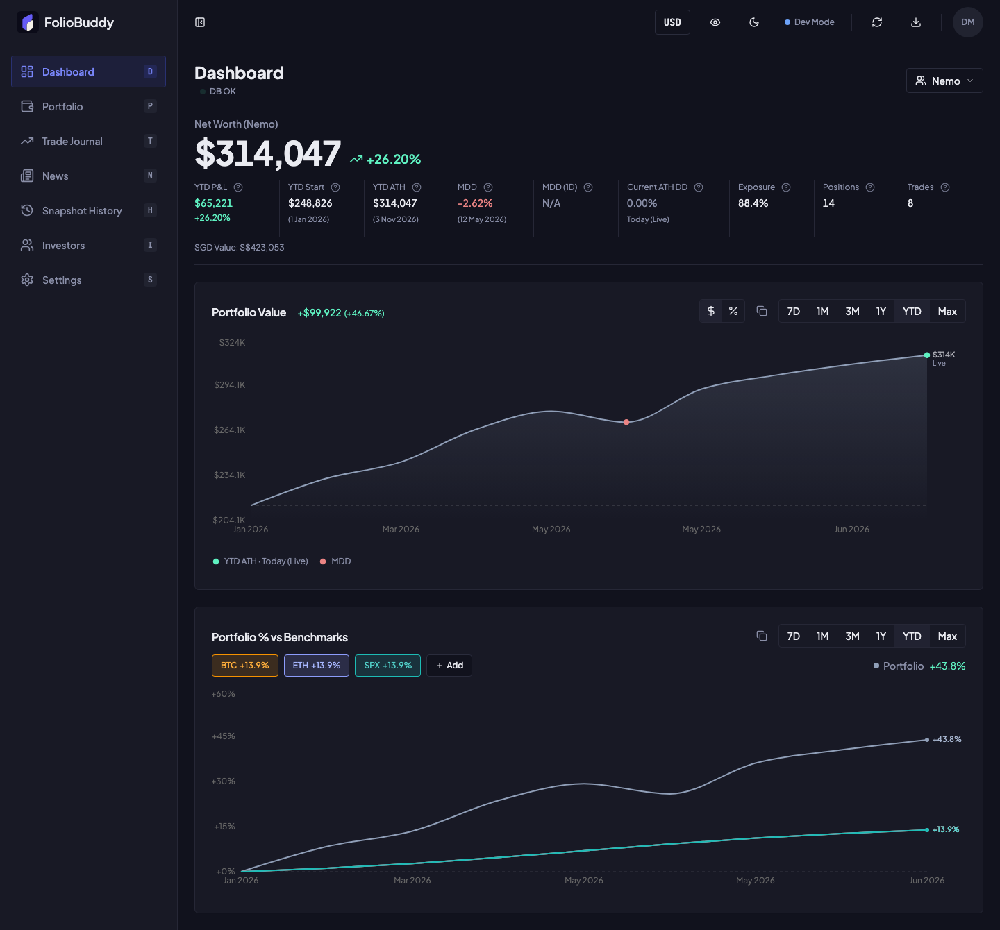
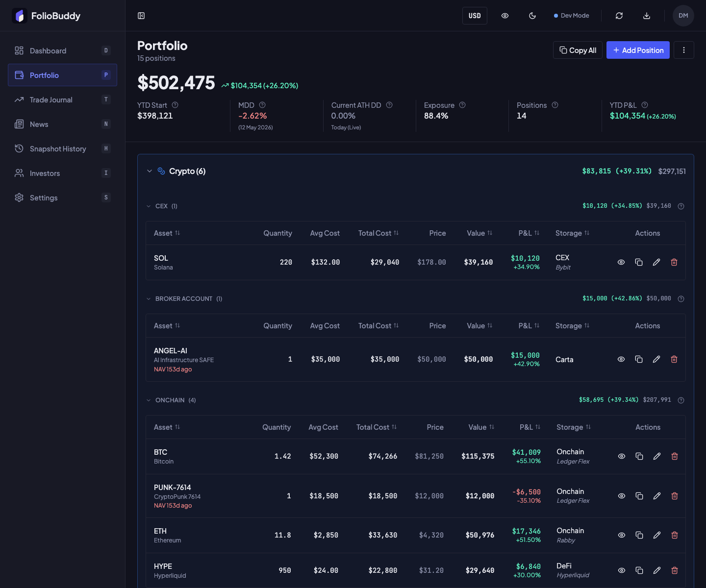
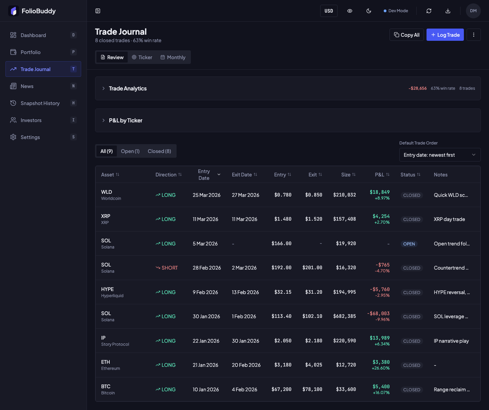

# FolioBuddy

A personal investing dashboard for tracking holdings, net worth and trades across crypto, equities and cash.
Bring positions from different brokers, exchanges, wallets and banks into one view, then review allocation and performance over time.

[Open the app](https://foliobuddy.xyz) · [Run locally](#run-locally) · [Architecture](docs/CODEBASE.md)



Screenshots use the development demo, with fictional holdings, trade amounts and performance history.

## Features

- **Portfolio tracking:** crypto, stocks, ETFs, unit trusts and cash, grouped by asset type and storage location.
- **Performance review:** net worth history, allocation charts, benchmark comparisons, drawdowns and exposure.
- **Trade journal:** open and closed trades, P&L analytics, ticker dossiers and monthly post-mortems.
- **Imports and currencies:** multi-currency holdings, supported unit trust PDF statements, JSON imports and optional read-only Interactive Brokers sync.
- **Holdings-aware news:** a news feed organised around portfolio positions and open trades.
- **Investor tracking and privacy:** investor stakes and ownership views, plus a control to hide monetary values across the interface.

<details>
<summary>More screenshots: portfolio and trade journal</summary>

### Portfolio



### Trade journal



</details>

## Tech stack

- **Frontend:** React, TypeScript, Vite, Tailwind CSS, Radix UI, TanStack Query, Zustand and Recharts.
- **Backend:** Node.js, Express, Prisma and PostgreSQL.
- **Integrations:** Clerk authentication, CoinGecko and Yahoo Finance market data, and an optional local IBKR sync helper.

Built as a personal project using AI-assisted development with Claude Code and Codex.

## Run locally

Use Node.js 20.19+ or 22.12+, npm 10.8.2, and either local PostgreSQL or Docker Desktop.

```bash
git clone https://github.com/n3moxyz/foliobuddy.git
cd foliobuddy
npm run sandbox
```

The sandbox installs dependencies, prepares a separate local database and opens the app at **http://localhost:4100** with a sample user already signed in.

See [testing and sandbox setup](docs/TESTING.md) for details, or [first-run configuration](AGENTS.md#first-run-setup) for development with Clerk authentication.

## Project structure

```text
packages/frontend/   React application
packages/backend/    Express API, database schema and background jobs
packages/shared/     Shared types and portfolio calculations
scripts/             Local development, sync and verification tools
```

[Deployment](DEPLOYMENT.md) · [Dependency notes](docs/DEPENDENCIES.md) · [Apache 2.0 license](LICENSE)
